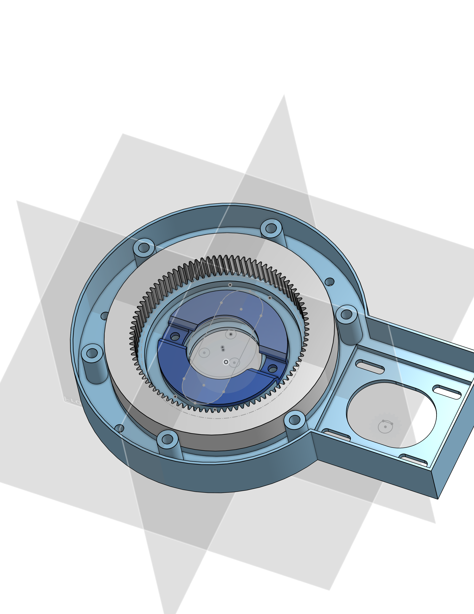
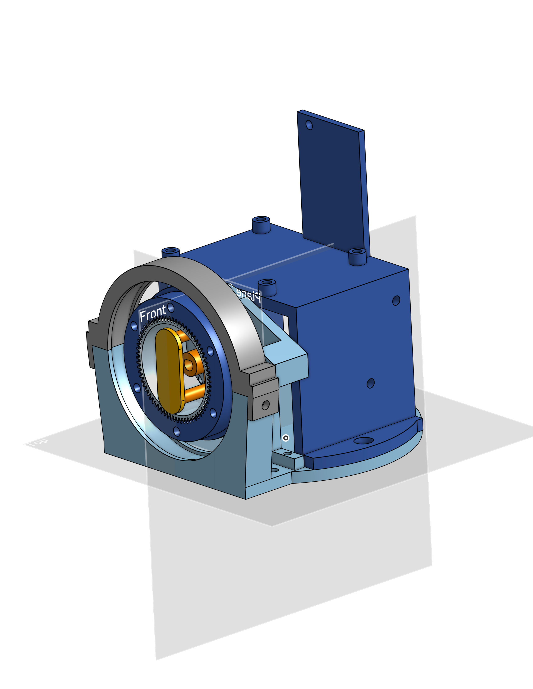
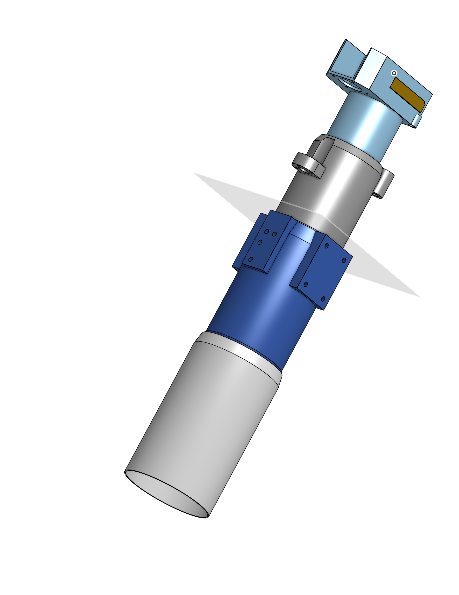
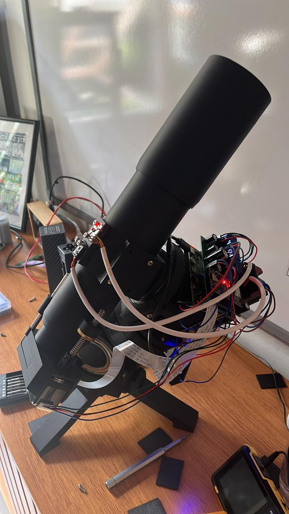

DIY Equatorial Telescope Mount

This repository contains the mechanical design and 3D models of a DIY equatorial telescope mount, developed as a personal project.

The goal of this project is to build a functional, precise, and affordable telescope mount using custom-designed mechanical components and harmonic drive gear reductions.

## Project Overview

The design includes:

- Equatorial mount mechanical structure
- Right Ascension (RA) and Declination (DEC) axes
- Harmonic drive gear reduction mechanisms
- Custom mechanical components and mounting assemblies
- 3D models for manufacturing and assembly

**Note:** This repository contains the mechanical design only, including the harmonic drive mechanisms. It does **not** include the electronics, motor controllers, wiring, firmware, or software required to operate the telescope.

## Design Preview

### Right Ascension Axis

### Declination Axis

### Mechanical Design

## Telescope

## Manufacturing and Assembly

The mechanical components were designed for DIY manufacturing and assembly.

The repository provides a starting point for anyone interested in building or modifying their own equatorial telescope mount.

Some components may require 3D printing, machining, or additional commercially available hardware.

## Project Status

This is an ongoing personal project. Designs may be updated as improvements are made and components are tested.

## Disclaimer

The designs are provided for educational and experimental purposes. They may require modifications depending on the available manufacturing tools, materials, and intended telescope configuration.

## License

License information will be added separately.
